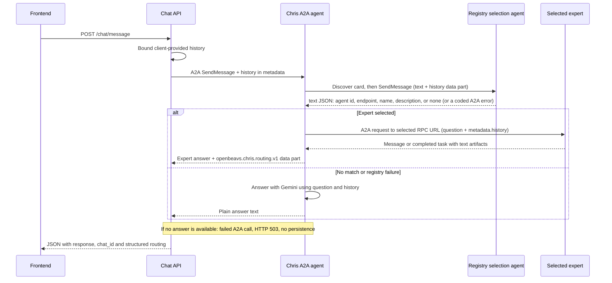

# Conversation Agent

The one part of the Chat System with an LLM. It takes each message from Application Services, asks the Agent Registry which expert fits, and relays that expert's answer or answers itself.

- Ask the Agent Registry over A2A about every message, sending bounded conversation text. The Registry decides whether an expert fits.
- Call the one expert the Registry returns.
- Relay the expert's answer unchanged, or, when the Registry finds no expert or fails, answer from general knowledge with Gemini, with no expert badge.
- When an expert is slow, down, or refuses, fail the turn, so the user sees a notice that Chris is unavailable instead of an answer.

Conventional code inside this component makes each A2A call and reports which expert answered, in the routing data it returns to Application Services. The model's output never supplies the source.

It has no database. Application Services hands it the message and the bounded history each turn, and the agent keeps its own bound on the history it sends the Registry and the expert.

It is its own Python package, `conversation_agent`, in this folder, with its own environment and lock file. Its tests run in that environment, and one of them checks that neither Application Services nor the Agent Registry can be imported there.

**Later:** it interprets the question itself and decides when an expert would help; and it passes the user's identity from the session to the expert.

Moved here from the dev branch: `backend/app/chris/`, its tests from `backend/tests/`, and `docs/chris.md`, which follows.

Chris is a custom Google ADK `BaseAgent` exposed over A2A 1.0. The chat API owns
transient conversation history; Chris owns the deterministic registry-first
workflow.

Chris asks the registry which expert fits, calls its RPC endpoint, and returns the
expert's answer with routing metadata. No-match and registry failures use Gemini.

## Current request flow



Every valid message attempts registry selection once, including greetings. The
sequence is enforced in Python, not by a model prompt. The registry owns its own
selection instructions; Chris sends the current message and conversation history.

The configured registry is a separate service (`agent_registry.a2a_app`, in
`agent-registry/`, run on its own). It serves this A2A selection and also the `/registry/*` routes that manage
stored agents and reviews; the chat API serves neither.

Chris logs selection details and failure types in its terminal. Chris calls the
selected expert once. Chat returns the answer with the expert's name and description,
which Chris passes through from the registry's reply.
If no expert matches or registry selection fails, Chris tries Gemini. If an expert
call fails or returns an unfinished or empty reply, Chat returns HTTP 503. Failed
turns are not saved or added to browser history.

Internal registry codes remain in Chris's client for classification and logging.
They are not included in Chris-to-Chat routing data or browser-facing schemas.

## Chris's A2A API

- `GET /chris/a2a/.well-known/agent-card.json`: ADK-generated discovery card.
- `POST /chris/a2a/`: JSON-RPC A2A 1.0 endpoint; use the SDK's `SendMessageRequest`.

Chris's own process serves both (`python -m conversation_agent.run`, port 8000 locally, or
`uvicorn conversation_agent.run:create_app --factory` on a chosen host and port); the chat
API's server does not. The old handwritten `/chris/.well-known/agent.json` route
is removed. The card advertises text input/output, protocol 1.0 and no streaming. Discovery is
shared, but each RPC initializes a separate ADK application with its own in-memory
task store, executor, and session service. These stores have no application-wide
references after execution finishes; completed turns do not accumulate in Chris.
The SDK continues to handle protocol validation, execution, and responses.

`ListTasks` is rejected. Retrieval, subscription, cancellation, and resuming a
previous task cannot access other requests' stores and return SDK errors. Supplying
a previous context ID starts with a fresh session rather than loading earlier
events. Task polling and cross-request continuation are unsupported until caller
isolation is implemented.

Chat calls a configured Chris endpoint without fetching its card. It sends the
message as a text part and previous turns in request-level `metadata.history`.
It does not send chat IDs, guest tokens, user identities or database sessions to
Chris. Chris accepts only user/assistant history entries with string content and
forwards those entries to the registry or Gemini. Each chat turn starts a fresh A2A
context; replayed history supplies continuity. A2A metadata does not grant access
to stored application chats.

## Registry selection contract

`REGISTRY_A2A_URL` is the registry's base A2A URL (for the local setup
`http://127.0.0.1:8001/a2a/registry`). For each selection, the SDK fetches
`<base>/.well-known/agent-card.json`, then sends a JSON-RPC request to the endpoint
advertised by that card. The request has a **text part** (the question) and a **data
part** `{"history": [{"role", "content"}, ...]}` (the registry's documented contract; it
also tolerates `metadata.history`, but only when no data part has a history).

The registry replies with one message whose single **text part** is compact JSON,
trimmed to what Chris needs:
`{"agent": {"id": "...", "endpoint_url": "...", "name": "...", "description": "..." or null}}`
or `{"agent": "none"}` (see [the Agent Registry](../../agent-registry/README.md)). Chris validates it strictly: exact
keys, non-empty strings for `id` and `endpoint_url`, a string `name` (it may be blank;
the expert still answers and the interface shows no "Answered by" line), a string or
null `description`, no coercion; anything else is `registry_invalid_reply` and Chris never
guesses. There is no confidence or reason on the wire. Chris keeps the endpoint for
dispatch and forwards the id, name and description to Chat in the
`openbeavs.chris.routing.v1` data part
(`{"schema", "status", "agent": {"id", "name", "description"}}`), so `routing.agent`
carries the registry's values and Chat reads no `agents` table (`confidence` and
`reason` stay null). A registry that cannot select answers with an
A2A error whose message is a short code (`selection_unavailable`, `agent_unavailable`,
...); Chris classifies it internally with `source = "registry"` for terminal logging.

Failures Chris itself observes become coded `error` results: `registry_not_configured`,
`registry_timeout`, `registry_unreachable`, `registry_auth_rejected` (401/403),
`registry_protocol_error`, `registry_invalid_reply`. Discovery and selection share one
deadline, `REGISTRY_A2A_TIMEOUT_SECONDS` (default 14 s, allowed 1 to 60); there is no
application retry or task polling. Chris sends **no credential**: that is correct only
for the registry's local-development mode, and attaching a Google identity token for a
deployed registry is not implemented.

## Expert dispatch

`conversation_agent/expert_client.py` calls the exact RPC URL supplied by the registry;
there is no inferred discovery path or redirected destination. The registry contract
contains no protocol version, so `CHRIS_EXPERT_A2A_VERSION` selects `0.3` (default,
SDK `message/send`, matching the seeded experts) or `1.0` (SDK `SendMessage`). This setting applies to all experts
in this Chris deployment; mixed-version routing needs protocol metadata added to
the registry contract in future work. No database access is required by Chris.

The request carries the question in a text part and bounded prior user/assistant
turns in request-level `metadata.history`. Experts must implement that history
contract to use earlier turns. Each turn uses a fresh message ID and no reused
context or task ID. Only message text or completed-task artifact text is returned;
expert data parts cannot replace Chris's routing metadata. There is no streaming,
polling, or automatic retry.

Only public HTTPS destinations are supported. Chris revalidates DNS and URL safety
at dispatch, rejects credentials, queries, fragments and malformed URLs, and disables
redirects and environment proxies. These checks are the agent's own copy of the
registry's registration rules (`conversation_agent/security.py`), and they share its
DNS-rebinding gap between validation and connection; production egress restrictions
are needed to close it. Private/loopback endpoints are not supported by this path.
No user credentials or service tokens are forwarded. Authenticated expert endpoints
remain unsupported and return an unavailable response on auth rejection.

`CHRIS_EXPERT_TIMEOUT_SECONDS` bounds validation plus the full exchange (default
30 seconds, allowed 1–60). Invalid timeout values use the default. Transport and
protocol failures log a safe classification (timeout, connection, auth, HTTP, unsafe
URL, or protocol failure), HTTP status when available, and the underlying exception
type. URLs, credentials and response bodies are omitted; callers receive a generic error.

## Gemini fallback (enabled by default)

`conversation_agent/gemini.py` uses the asynchronous `google-genai` SDK's `generate_content`
API. It supplies Chris's system instruction, maps assistant history to the model
role, and appends the current user message once. The call has a 15-second deadline
and one attempt. Credentials are read when fallback is needed, not at startup.
Provider errors are replaced with a generic error without echoing their details.
There is no Gemini Interactions API call or `store: false` setting in this path;
this branch does not establish a provider-retention guarantee.

Chat's overall A2A deadline is 50 seconds (`CHRIS_A2A_TIMEOUT_SECONDS`), Chris's registry
deadline is 14 seconds, expert dispatch is bounded to 30 seconds, optional Gemini
fallback to 15 seconds, and the frontend waits up to 90 seconds; see
[the registry timeout settings](../../agent-registry/README.md#registry-caller-timeout) for the selection deadline.
Timeouts in different layers do not prove a downstream operation was canceled;
there are no automatic frontend POST retries.

## Configuration

Set these privately in the process environment or the ignored `.env` at the repository root:

| Variable | Default / use |
| --- | --- |
| `CHRIS_A2A_URL` | `http://127.0.0.1:8000/chris/a2a/`; chat's configured destination. |
| `CHRIS_PUBLIC_URL` | `http://localhost:8000`; public base URL advertised by Chris's card. |
| `REGISTRY_A2A_URL` | `http://127.0.0.1:8001/a2a/registry`; registry base URL for SDK discovery. |
| `REGISTRY_A2A_TIMEOUT_SECONDS` | `14`; one deadline for registry discovery plus selection. |
| `CHRIS_A2A_TIMEOUT_SECONDS` | `50`; must exceed registry + expert deadlines plus response overhead. |
| `CHRIS_EXPERT_TIMEOUT_SECONDS` | `30`; expert validation and call deadline, allowed 1–60. |
| `CHRIS_EXPERT_DEBUG` | `false`; set `true` to log expert dispatch and completion details in Chris's process. |
| `CHRIS_EXPERT_A2A_VERSION` | `0.3`; use `1.0` for experts implementing `SendMessage`. |
| `GEMINI_API_KEY` | Used for Gemini fallback; never put its value in docs, logs or commits. |
| `CHRIS_MODEL` | Gemini model ID, used for fallback. |
| `DATABASE_URL` | Chat's and the registry's databases, `sqlite:///./openbeavs.db` by default; Chris has no database and reads none. |

The registry URL is operator configuration, never a frontend-supplied destination.
With no registry listening, Chris logs `registry_unreachable` and tries Gemini.
`CHRIS_USE_MOCK_AGENTS` and the old local mock list have been removed.

Dependencies: `google-adk[a2a]==2.13.0`, `a2a-sdk[http-server]==1.3.0`, and
`google-genai>=2.30,<3`, with resolved versions in this folder's `uv.lock`. ADK's A2A
integration emits experimental warnings; those warnings alone are not failures.

## Running and deployment status

Chris runs only as its own process. The chat API (`application_services.main:app`) does not host
Chris's A2A endpoint; it calls the address in `CHRIS_A2A_URL` over HTTP/A2A. Any
deployment therefore runs Chris as a separate service beside the chat API and the
registry, and sets `CHRIS_A2A_URL` (for chat) and `CHRIS_PUBLIC_URL` (for Chris's
card) to that service's address.

The [root README](../../README.md) launcher starts all of them locally, Chris from this
folder with its own environment. To start Chris by hand, from `chat-system/conversation-agent/`:

```zsh
uv sync --locked
uv run python -m conversation_agent.run
```

That runner binds `127.0.0.1:8000`, the local development address; it reads no host
or port setting. A deployment that needs another address serves the same application
with uvicorn, exactly as the registry and the chat API are served:

```bash
uv run uvicorn conversation_agent.run:create_app --factory --host 0.0.0.0 --port 8080
```

Both routes build the same app and configure the same logging, including
`CHRIS_EXPERT_DEBUG`. Set `CHRIS_PUBLIC_URL` to the address callers reach, since the
card advertises it, and point the chat API's `CHRIS_A2A_URL` at
`<that address>/chris/a2a/`. Start the chat API on
another port (the launcher uses 8010). One browser message produces a
`/chat/message` access-log entry in the chat API's console and a `/chris/a2a/` entry
in Chris's. Cloud-ready startup, a container definition, and service-to-service token
authentication are not implemented in this repository. No A2A client attaches an IAM
ID token, and Chris's endpoint has no caller-authentication middleware.
Chris advertises no streaming; both clients use non-streaming calls.

## Layout and remaining work

Chris, in this folder:

```text
conversation_agent/agent.py           registry-first expert dispatch or Gemini fallback
conversation_agent/expert_client.py   validated direct RPC call, deadline, text extraction
conversation_agent/registry_client.py SDK discovery, selection request and failure classification
conversation_agent/routing.py         registry contract validation and Chris's routing result
conversation_agent/gemini.py          direct Gemini generation
conversation_agent/a2a.py             generated card and A2A app
conversation_agent/transport.py       request-scoped SDK stores; task enumeration denied
conversation_agent/run.py             standalone entrypoint and app factory
conversation_agent/config.py          the settings Chris reads, from the environment or .env
conversation_agent/history.py         the bound on the history Chris sends the registry and experts
conversation_agent/security.py        the safe-URL checks applied before an expert is called
tests/                                Chris's tests, run in this folder's environment
```

The chat API that calls Chris, and its contract with the browser, are in
[Application Services](../application-services/README.md#frontend-api).

A2A caller authentication, authenticated expert invocation, mixed-version expert routing, streaming in the Web UI, saved-chat retrieval, and
automated TTL cleanup remain future work. See [registry](../../agent-registry/README.md) and
[the Web UI](../web-ui/README.md) for their separate responsibilities.
