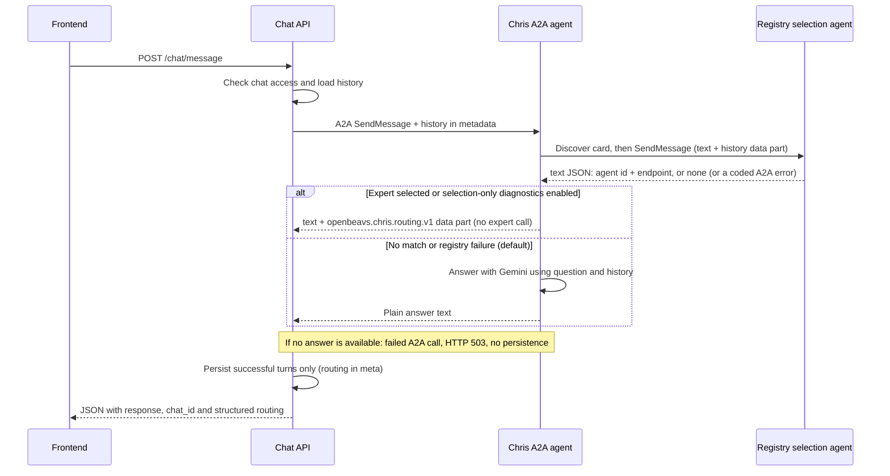

# Chris agent and chat API

Chris is a custom Google ADK `BaseAgent` exposed over A2A 1.0. The chat API owns
conversation access and persistence; Chris owns the deterministic registry-first
workflow.

> **Current stage: selection with Gemini fallback.** Chris asks the registry which
> expert fits and reports a selected expert as a structured result. It does not call
> that expert yet. By default, Chris answers with Gemini when no expert matches or
> the registry fails. Set `CHRIS_SELECTION_ONLY=true` to inspect registry outcomes
> without fallback. See [the registry workflow guide](registry.md#integrated-selection-workflow).

## Current request flow



Every valid message attempts registry selection once, including greetings. The
sequence is enforced in Python, not by a model prompt. The registry owns its own
selection instructions; Chris sends the current message and conversation history.

The configured registry is a separate A2A service. The existing `/registry/*`
FastAPI routes manage stored agents and reviews; they do not implement this A2A
selection service (that is `app.registry.a2a_app`, run on its own).

Chris logs selection details and backend failure codes in its terminal. Successful
selections become a plain message such as "I found the Math Expert specialist for
your question." This acknowledges the selection; it is not an expert answer.

With `CHRIS_SELECTION_ONLY=false` (the default), no-match and registry failures use
Gemini. With `true`, a diagnostic no-match remains a plain message and failures
become failed A2A calls. If Gemini also fails, Chris likewise fails the A2A call.
Chat returns a generic HTTP 503 notice before persistence. Failed turns are neither
saved as user/assistant messages nor replayed as history. Backend configuration
errors similarly return a generic HTTP 500 without saving a turn.

Internal registry codes remain in Chris's client for classification and logging.
They are not included in Chris-to-Chat routing data or browser-facing schemas.

## Frontend API

| Method | Path | Behavior |
| --- | --- | --- |
| GET | `/health` | Returns `{"status":"ok","app":"OpenBeavs v2"}`; does not check dependencies. |
| POST | `/chat/message` | Check access, load history, call Chris over A2A, and persist the reply. |
| GET | `/chat/agents` | Read-only directory of active, reviewed public agents with no required role; excludes Chris. |
| DELETE | `/chat/chats/expired` | Purge expired chats. No scheduler is installed. |

The former `/chris/message`, `/chris/agents`, and `/chris/chats/expired` paths have
been replaced by `/chat/*`; no compatibility aliases are registered.

### `POST /chat/message`

```json
{
  "message": "What majors does OSU offer?",
  "history": [{"role":"user","content":"Earlier question"}],
  "chat_id": "optional-chat-id",
  "user_id": null,
  "guest_session_id": "client-generated-guest-id",
  "source_domain": "library.oregonstate.edu"
}
```

A response has this shape:

```json
{
  "response": "I found the Math Expert specialist for your question.",
  "chat_id": "persisted-chat-id",
  "routed_to": "math-expert",
  "agent_name": "Math Expert",
  "routing_confidence": null,
  "routing_reason": null,
  "routing": {
    "status": "selected",
    "agent": {"id": "math-expert", "name": "Math Expert", "description": "..."},
    "confidence": null,
    "reason": null
  }
}
```

`routing` retains successful selection metadata: `status` is `selected` or diagnostic
`no_match`. Only selected agents have an `agent`; endpoints are never sent to the
browser. There is no error field. The UI renders `response` in a normal bubble and
does not display routing metadata. `routing` is null for Gemini answers. The older
flat fields mirror a selected result and are null otherwise. `chat_id` may be null
if persistence fails after Chris has answered. Existing chats use stored history; a database history-read failure
falls back to the client-provided history. The client should omit the current
message from `history`, because it is supplied separately.

Errors: 400 for blank message text, 403 for denied access to an existing chat, 422
for invalid request bodies, 500 for chat-to-Chris configuration errors, and 503
when Chris cannot produce a completed A2A reply (including a malformed routing
result). A registry failure that Chris reports as `routing.status = "error"` returns
200, not 503: the pipeline worked and is reporting what went wrong.

`user_id` is a caller-supplied database lookup, not a verified SSO identity. The
current frontend omits it and supplies its guest identifier. Tokenless legacy
chats remain accessible under the existing prototype checks. Guest chats get a
two-hour expiry timestamp; expiry does not itself reject turns or trigger deletion.

## Chris's A2A API

- `GET /chris/a2a/.well-known/agent-card.json`: ADK-generated discovery card.
- `POST /chris/a2a/`: JSON-RPC A2A 1.0 endpoint; use the SDK's `SendMessageRequest`.

The old handwritten `/chris/.well-known/agent.json` route is removed. The mounted
card advertises text input/output, protocol 1.0 and no streaming. Discovery is
shared, but each RPC initializes a separate ADK application with its own in-memory
task store, executor, and session service. These stores have no application-wide
references after execution finishes; completed turns do not accumulate in Chris.
The SDK continues to handle protocol validation, execution, and responses.

`ListTasks` is rejected. Retrieval, subscription, cancellation, and resuming a
previous task cannot access other requests' stores and return SDK errors. Supplying
a previous context ID starts with a fresh session rather than loading earlier
events. These restrictions also apply to the standalone runner. Task polling and
cross-request continuation are unsupported until caller isolation is implemented.

Chat calls a configured Chris endpoint without fetching its card. It sends the
message as a text part and previous turns in request-level `metadata.history`.
It does not send chat IDs, guest tokens, user identities or database sessions to
Chris. Chris accepts only user/assistant history entries with string content and
forwards those entries to the registry or Gemini. Each chat turn starts a fresh A2A
context; replayed history supplies continuity. A2A metadata does not grant access
to stored application chats.

## Registry selection contract

`REGISTRY_A2A_URL` is the registry's base A2A URL (for the local setup
`http://127.0.0.1:8001/a2a/registry`). For each selection, the SDK fetches
`<base>/.well-known/agent-card.json`, then sends a JSON-RPC request to the endpoint
advertised by that card. The request has a **text part** (the question) and a **data
part** `{"history": [{"role", "content"}, ...]}` (the registry's documented contract; it
also tolerates `metadata.history`, but only when no data part has a history).

The registry replies with one message whose single **text part** is compact JSON,
trimmed to what Chris needs: `{"agent": {"id": "...", "endpoint_url": "..."}}` or
`{"agent": "none"}` (see [registry.md](registry.md)). Chris validates it strictly: exact
keys, non-empty strings, no coercion; anything else is `registry_invalid_reply` and Chris
never guesses. There is no name, description, confidence or reason on the wire; Chat looks
the display name and description up in its own `agents` table (so `routing.agent` has them,
and `confidence` and `reason` stay null). A registry that cannot select answers with an
A2A error whose message is a short code (`selection_unavailable`, `agent_unavailable`,
...); Chris classifies it internally with `source = "registry"` for terminal logging.

Failures Chris itself observes become coded `error` results: `registry_not_configured`,
`registry_timeout`, `registry_unreachable`, `registry_auth_rejected` (401/403),
`registry_protocol_error`, `registry_invalid_reply`. Discovery and selection share one
deadline, `REGISTRY_A2A_TIMEOUT_SECONDS` (default 14 s, allowed 1 to 60); there is no
application retry or task polling. Chris sends **no credential**: that is correct only
for the registry's local-development mode, and attaching a Google identity token for a
deployed registry is not implemented.

## Gemini fallback (enabled by default)

`app/chris/gemini.py` uses the asynchronous `google-genai` SDK's `generate_content`
API. It supplies Chris's system instruction, maps assistant history to the model
role, and appends the current user message once. The call has a 15-second deadline
and one attempt. Credentials are read when fallback is needed, not at startup.
Provider errors are replaced with a generic error without echoing their details.
There is no Gemini Interactions API call or `store: false` setting in this path;
this branch does not establish a provider-retention guarantee.

Chat's overall A2A deadline is 35 seconds (`CHRIS_A2A_TIMEOUT_SECONDS`), Chris's registry
deadline is 14 seconds, optional fallback is bounded to 15 seconds, and the frontend waits up to 90 seconds; see
[the registry timeout settings](registry.md#timeouts-and-bounded-history) for how they nest.
Timeouts in different layers do not prove a downstream operation was canceled;
there are no automatic frontend POST retries.

## Configuration

Set these privately in the process environment or ignored `backend/.env`:

| Variable | Default / use |
| --- | --- |
| `CHRIS_A2A_URL` | `http://127.0.0.1:8000/chris/a2a/`; chat's configured destination. |
| `CHRIS_PUBLIC_URL` | `http://localhost:8000`; public base URL used by the card mounted in `app.main`. |
| `REGISTRY_A2A_URL` | `http://127.0.0.1:8001/a2a/registry`; registry base URL for SDK discovery. |
| `REGISTRY_A2A_TIMEOUT_SECONDS` | `14`; one deadline for registry discovery plus selection. |
| `CHRIS_A2A_TIMEOUT_SECONDS` | `35`; chat's deadline for Chris (must exceed the registry deadline). |
| `CHRIS_SELECTION_ONLY` | `false`; set `true` to report registry outcomes without Gemini fallback. |
| `GEMINI_API_KEY` | Needed only when `CHRIS_SELECTION_ONLY=false`; never put its value in docs, logs or commits. |
| `CHRIS_MODEL` | Gemini model ID, needed only when `CHRIS_SELECTION_ONLY=false`. |
| `DATABASE_URL` | Chat/registry database; defaults to `sqlite:///./openbeavs.db`. |

The registry URL is operator configuration, never a frontend-supplied destination.
With no registry listening, Chris reports `registry_unreachable` (or uses Gemini only when
`CHRIS_SELECTION_ONLY=false`). The directory
still reads stored eligible agents, but that list does not drive Chris's selection.
`CHRIS_USE_MOCK_AGENTS` and the old local mock list have been removed.

Dependencies: `google-adk[a2a]==2.13.0`, `a2a-sdk[http-server]==1.3.0`, and
`google-genai>=2.30,<3`, with resolved versions in `backend/uv.lock`. ADK's A2A
integration emits experimental warnings; those warnings alone are not failures.

## Running and deployment status

The usual local setup runs both chat and the mounted Chris agent in one process:

```powershell
cd backend
uv sync --locked
python -m app.db.init_db
python -m uvicorn app.main:app --reload --host 127.0.0.1 --port 8000
```

The backend calls its own Chris endpoint over HTTP/A2A. Two access-log entries
(`/chat/message` and `/chris/a2a/`) are expected for one browser message.

`python -m app.chris.run` starts only Chris, without chat or its database routes.
That runner currently binds `127.0.0.1:8000` and uses the same card builder and
request isolation as the mounted agent, including `CHRIS_PUBLIC_URL`. It does not
use `PORT`; do not run it alongside the main app on the same
port. Cloud-ready startup, a container definition, and service-to-service token
authentication are not implemented by this branch. No A2A client attaches an IAM
ID token, and the mounted Chris endpoint has no caller-authentication middleware.
Both entrypoints advertise no streaming; both clients use non-streaming calls.

## Layout and remaining work

```text
app/chat/router.py          frontend REST routes
app/chat/schemas.py         frontend request/response models
app/chat/service.py         access checks, history, persistence, directory
app/chat/a2a_client.py      SDK client adapter that calls Chris
app/chris/agent.py          registry-first flow (Gemini fallback only when enabled)
app/chris/registry_client.py SDK discovery, selection request and failure classification
app/chris/routing.py        registry contract validation and Chris's routing result
app/chris/gemini.py         direct Gemini generation
app/chris/a2a.py            generated card and mounted A2A app
app/chris/transport.py      request-scoped SDK stores; task enumeration denied
app/chris/run.py            local standalone entrypoint
```

Selected-specialist invocation, a real registry selection service, A2A caller
authentication, verified SSO, streaming in the frontend, saved-chat retrieval, and
automated TTL cleanup remain future work. See [registry](registry.md) and
[frontend integration](frontend.md) for their separate responsibilities.
