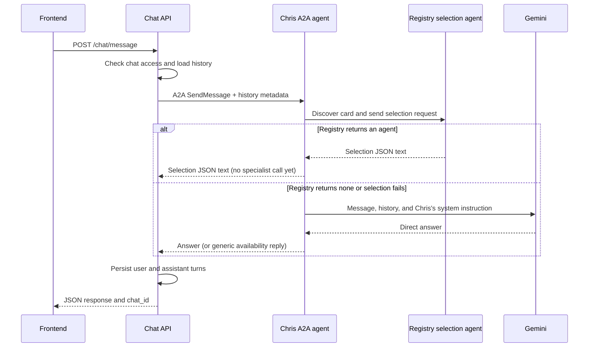

# Chris agent and chat API

Chris is a custom Google ADK `BaseAgent` exposed over A2A 1.0. The chat API owns
conversation access and persistence; Chris owns the deterministic registry-first
workflow and direct Gemini fallback.

## Current request flow



Every valid message attempts registry selection once, including greetings. The
sequence is enforced in Python, not by a model prompt. The registry owns its own
selection instructions; Chris sends the current message and conversation history.

The configured registry is a separate A2A service. The existing `/registry/*`
FastAPI routes manage stored agents and reviews; they do not implement this A2A
selection service. No fake registry service ships with this branch.

If the registry selects an agent, Chris currently returns the selection JSON as
text. It does **not** call the selected specialist. If selection fails or returns
`{"agent":"none"}`, Chris calls Gemini. If Gemini is unconfigured or unavailable,
Chris returns `Chris is temporarily unavailable. Please try again shortly.` as a
normal completed text response. Chat persists that response like other answers.

## Frontend API

| Method | Path | Behavior |
| --- | --- | --- |
| GET | `/health` | Returns `{"status":"ok","app":"OpenBeavs v2"}`; does not check dependencies. |
| POST | `/chat/message` | Check access, load history, call Chris over A2A, and persist the reply. |
| GET | `/chat/agents` | Read-only directory of active, reviewed public agents with no required role; excludes Chris. |
| DELETE | `/chat/chats/expired` | Purge expired chats. No scheduler is installed. |

The former `/chris/message`, `/chris/agents`, and `/chris/chats/expired` paths have
been replaced by `/chat/*`; no compatibility aliases are registered.

### `POST /chat/message`

```json
{
  "message": "What majors does OSU offer?",
  "history": [{"role":"user","content":"Earlier question"}],
  "chat_id": "optional-chat-id",
  "user_id": null,
  "guest_session_id": "client-generated-guest-id",
  "source_domain": "library.oregonstate.edu"
}
```

A response has this shape:

```json
{
  "response": "The answer text, registry selection JSON text, or an availability reply",
  "chat_id": "persisted-chat-id",
  "routed_to": null,
  "agent_name": null,
  "routing_confidence": null,
  "routing_reason": null
}
```

Routing fields remain in the frontend contract but are currently null, even when
Chris receives a selection. `chat_id` may be null if persistence fails after Chris
has answered. Existing chats use stored history; a database history-read failure
falls back to the client-provided history. The client should omit the current
message from `history`, because it is supplied separately.

Errors: 400 for blank message text, 403 for denied access to an existing chat, 422
for invalid request bodies, 500 for chat-to-Chris configuration errors, and 503
when Chris cannot produce a completed text A2A reply. Registry/Gemini failures that
Chris converts into an availability message return 200, not 503.

`user_id` is a caller-supplied database lookup, not a verified SSO identity. The
current frontend omits it and supplies its guest identifier. Tokenless legacy
chats remain accessible under the existing prototype checks. Guest chats get a
two-hour expiry timestamp; expiry does not itself reject turns or trigger deletion.

## Chris's A2A API

- `GET /chris/a2a/.well-known/agent-card.json`: ADK-generated discovery card.
- `POST /chris/a2a/`: JSON-RPC A2A 1.0 endpoint; use the SDK's `SendMessageRequest`.

The old handwritten `/chris/.well-known/agent.json` route is removed. The mounted
card advertises text input/output, protocol 1.0 and no streaming. Discovery is
shared, but each RPC initializes a separate ADK application with its own in-memory
task store, executor, and session service. These stores have no application-wide
references after execution finishes; completed turns do not accumulate in Chris.
The SDK continues to handle protocol validation, execution, and responses.

`ListTasks` is rejected. Retrieval, subscription, cancellation, and resuming a
previous task cannot access other requests' stores and return SDK errors. Supplying
a previous context ID starts with a fresh session rather than loading earlier
events. These restrictions also apply to the standalone runner. Task polling and
cross-request continuation are unsupported until caller isolation is implemented.

Chat calls a configured Chris endpoint without fetching its card. It sends the
message as a text part and previous turns in request-level `metadata.history`.
It does not send chat IDs, guest tokens, user identities or database sessions to
Chris. Chris accepts only user/assistant history entries with string content and
forwards those entries to the registry or Gemini. Each chat turn starts a fresh A2A
context; replayed history supplies continuity. A2A metadata does not grant access
to stored application chats.

## Registry selection contract

`REGISTRY_A2A_URL` is the registry's base URL. For each selection, the SDK fetches
`<base>/.well-known/agent-card.json`, then sends a JSON-RPC request to the endpoint
advertised by that card. Only the message text and `metadata.history` are supplied;
there is no routing instruction in the request.

The registry must return JSON **text**, either in an A2A Message or in artifacts of
a completed Task, with exactly one of these shapes:

```json
{"agent":{"id":"library-agent","endpoint_url":"https://example.com/a2a/"}}
```

```json
{"agent":"none"}
```

`null`, missing fields, extra selection fields, unfinished/failed tasks, empty text
and invalid JSON are rejected and trigger Gemini fallback. No confidence threshold
or local agent selection remains. Registry discovery and selection share a
five-second deadline; there is no application retry or task polling.

## Gemini fallback

`app/chris/gemini.py` uses the asynchronous `google-genai` SDK's `generate_content`
API. It supplies Chris's system instruction, maps assistant history to the model
role, and appends the current user message once. The call has a 15-second deadline
and one attempt. Credentials are read when fallback is needed, not at startup.
Provider errors are replaced with a generic error without echoing their details.
There is no Gemini Interactions API call or `store: false` setting in this path;
this branch does not establish a provider-retention guarantee.

Chat's overall A2A deadline is 30 seconds. The frontend waits up to 90 seconds.
Timeouts in different layers do not prove a downstream operation was canceled;
there are no automatic frontend POST retries.

## Configuration

Set these privately in the process environment or ignored `backend/.env`:

| Variable | Default / use |
| --- | --- |
| `CHRIS_A2A_URL` | `http://127.0.0.1:8000/chris/a2a/`; chat's configured destination. |
| `CHRIS_PUBLIC_URL` | `http://localhost:8000`; public base URL used by the card mounted in `app.main`. |
| `REGISTRY_A2A_URL` | `http://127.0.0.1:8001/`; registry base URL for SDK discovery. |
| `GEMINI_API_KEY` | Required for direct Gemini fallback; never put its value in docs, logs or commits. |
| `CHRIS_MODEL` | Required Gemini model ID for fallback. |
| `DATABASE_URL` | Chat/registry database; defaults to `sqlite:///./openbeavs.db`. |

The registry URL is operator configuration, never a frontend-supplied destination.
With no registry listening, selection fails and Gemini is used. The directory
still reads stored eligible agents, but that list does not drive Chris's selection.
`CHRIS_USE_MOCK_AGENTS` and the old local mock list have been removed.

Dependencies: `google-adk[a2a]==2.13.0`, `a2a-sdk[http-server]==1.3.0`, and
`google-genai>=2.30,<3`, with resolved versions in `backend/uv.lock`. ADK's A2A
integration emits experimental warnings; those warnings alone are not failures.

## Running and deployment status

The usual local setup runs both chat and the mounted Chris agent in one process:

```powershell
cd backend
uv sync --locked
python -m app.db.init_db
python -m uvicorn app.main:app --reload --host 127.0.0.1 --port 8000
```

The backend calls its own Chris endpoint over HTTP/A2A. Two access-log entries
(`/chat/message` and `/chris/a2a/`) are expected for one browser message.

`python -m app.chris.run` starts only Chris, without chat or its database routes.
That runner currently binds `127.0.0.1:8000` and uses the same card builder and
request isolation as the mounted agent, including `CHRIS_PUBLIC_URL`. It does not
use `PORT`; do not run it alongside the main app on the same
port. Cloud-ready startup, a container definition, and service-to-service token
authentication are not implemented by this branch. No A2A client attaches an IAM
ID token, and the mounted Chris endpoint has no caller-authentication middleware.
Both entrypoints advertise no streaming; both clients use non-streaming calls.

## Layout and remaining work

```text
app/chat/router.py          frontend REST routes
app/chat/schemas.py         frontend request/response models
app/chat/service.py         access checks, history, persistence, directory
app/chat/a2a_client.py      SDK client adapter that calls Chris
app/chris/agent.py          registry-first flow and Gemini fallback
app/chris/registry_client.py SDK discovery, selection request and response validation
app/chris/gemini.py         direct Gemini generation
app/chris/a2a.py            generated card and mounted A2A app
app/chris/transport.py      request-scoped SDK stores; task enumeration denied
app/chris/run.py            local standalone entrypoint
```

Selected-specialist invocation, a real registry selection service, A2A caller
authentication, verified SSO, streaming in the frontend, saved-chat retrieval, and
automated TTL cleanup remain future work. See [registry](registry.md) and
[frontend integration](frontend.md) for their separate responsibilities.
