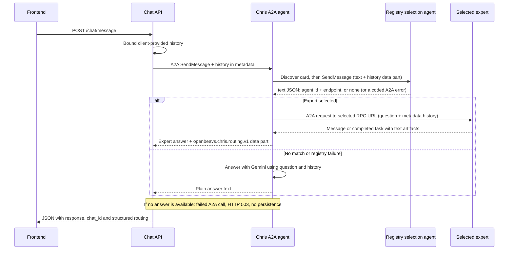

# Chris agent and chat API

Chris is a custom Google ADK `BaseAgent` exposed over A2A 1.0. The chat API owns
transient conversation history; Chris owns the deterministic registry-first
workflow.

Chris asks the registry which expert fits, calls its RPC endpoint, and returns the
expert's answer with routing metadata. No-match and registry failures use Gemini.

## Current request flow



Every valid message attempts registry selection once, including greetings. The
sequence is enforced in Python, not by a model prompt. The registry owns its own
selection instructions; Chris sends the current message and conversation history.

The configured registry is a separate A2A service. The existing `/registry/*`
FastAPI routes manage stored agents and reviews; they do not implement this A2A
selection service (that is `app.registry.a2a_app`, run on its own).

Chris logs selection details and failure types in its terminal. Chris calls the
selected expert once. Chat returns the answer and resolves the expert's display name.
If no expert matches or registry selection fails, Chris tries Gemini. If an expert
call fails or returns an unfinished or empty reply, Chat returns HTTP 503. Failed
turns are not saved or added to browser history.

Internal registry codes remain in Chris's client for classification and logging.
They are not included in Chris-to-Chat routing data or browser-facing schemas.

## Frontend API

| Method | Path | Behavior |
| --- | --- | --- |
| GET | `/health` | Returns `{"status":"ok","app":"OpenBeavs v2"}`; does not check dependencies. |
| POST | `/chat/message` | Bound client history and call Chris over A2A without saving transcripts. |
| GET | `/chat/agents` | Read-only directory of active, reviewed public agents with no required role; excludes Chris. |

The former `/chris/message` and `/chris/agents` paths have been replaced by
`/chat/message` and `/chat/agents`; no compatibility aliases are registered.

### `POST /chat/message`

```json
{
  "message": "What majors does OSU offer?",
  "history": [{"role":"user","content":"Earlier question"}],
  "source_domain": "library.oregonstate.edu"
}
```

A response has this shape:

```json
{
  "response": "The answer is 42.",
  "chat_id": null,
  "routed_to": "math-expert",
  "agent_name": "Math Expert",
  "routing_confidence": null,
  "routing_reason": null,
  "routing": {
    "status": "selected",
    "agent": {"id": "math-expert", "name": "Math Expert", "description": "..."},
    "confidence": null,
    "reason": null
  }
}
```

`routing` retains successful expert metadata with `status: "selected"`.
The schema accepts legacy `no_match` replies from older Chris instances. Endpoints are never sent to the
browser. There is no error field. The UI renders `response` in a normal bubble and
shows “Answered by” with `agent_name` for expert replies. `routing` is null for Gemini answers. The older
flat fields mirror a selected result and are null otherwise. `chat_id` is always
null for compatibility. The public endpoint is stateless: history comes only from
the request, bounded before forwarding to Chris. Omit the current message from
`history`, because it is supplied separately. Legacy `chat_id`, `guest_session_id`
and `user_id` request fields are ignored, including IDs belonging to real users.
No conversation history, routing metadata or guest identifier is saved to the DB.

Errors: 400 for blank message text, 422 for invalid request bodies, 500 for
chat-to-Chris configuration errors, and 503 when Chris cannot produce a completed
A2A reply. Failed turns are not added to the browser's successful history.

The database owner handles deletion of existing guest chats and their messages
separately. The former `DELETE /chat/chats/expired` endpoint is removed.
Verified SSO and account-backed chat storage are not implemented.

## Chris's A2A API

- `GET /chris/a2a/.well-known/agent-card.json`: ADK-generated discovery card.
- `POST /chris/a2a/`: JSON-RPC A2A 1.0 endpoint; use the SDK's `SendMessageRequest`.

The old handwritten `/chris/.well-known/agent.json` route is removed. The mounted
card advertises text input/output, protocol 1.0 and no streaming. Discovery is
shared, but each RPC initializes a separate ADK application with its own in-memory
task store, executor, and session service. These stores have no application-wide
references after execution finishes; completed turns do not accumulate in Chris.
The SDK continues to handle protocol validation, execution, and responses.

`ListTasks` is rejected. Retrieval, subscription, cancellation, and resuming a
previous task cannot access other requests' stores and return SDK errors. Supplying
a previous context ID starts with a fresh session rather than loading earlier
events. These restrictions also apply to the standalone runner. Task polling and
cross-request continuation are unsupported until caller isolation is implemented.

Chat calls a configured Chris endpoint without fetching its card. It sends the
message as a text part and previous turns in request-level `metadata.history`.
It does not send chat IDs, guest tokens, user identities or database sessions to
Chris. Chris accepts only user/assistant history entries with string content and
forwards those entries to the registry or Gemini. Each chat turn starts a fresh A2A
context; replayed history supplies continuity. A2A metadata does not grant access
to stored application chats.

## Registry selection contract

`REGISTRY_A2A_URL` is the registry's base A2A URL (for the local setup
`http://127.0.0.1:8001/a2a/registry`). For each selection, the SDK fetches
`<base>/.well-known/agent-card.json`, then sends a JSON-RPC request to the endpoint
advertised by that card. The request has a **text part** (the question) and a **data
part** `{"history": [{"role", "content"}, ...]}` (the registry's documented contract; it
also tolerates `metadata.history`, but only when no data part has a history).

The registry replies with one message whose single **text part** is compact JSON,
trimmed to what Chris needs: `{"agent": {"id": "...", "endpoint_url": "..."}}` or
`{"agent": "none"}` (see [registry.md](registry.md)). Chris validates it strictly: exact
keys, non-empty strings, no coercion; anything else is `registry_invalid_reply` and Chris
never guesses. There is no name, description, confidence or reason on the wire; Chat looks
the display name and description up in its own `agents` table (so `routing.agent` has them,
and `confidence` and `reason` stay null). A registry that cannot select answers with an
A2A error whose message is a short code (`selection_unavailable`, `agent_unavailable`,
...); Chris classifies it internally with `source = "registry"` for terminal logging.

Failures Chris itself observes become coded `error` results: `registry_not_configured`,
`registry_timeout`, `registry_unreachable`, `registry_auth_rejected` (401/403),
`registry_protocol_error`, `registry_invalid_reply`. Discovery and selection share one
deadline, `REGISTRY_A2A_TIMEOUT_SECONDS` (default 14 s, allowed 1 to 60); there is no
application retry or task polling. Chris sends **no credential**: that is correct only
for the registry's local-development mode, and attaching a Google identity token for a
deployed registry is not implemented.

## Expert dispatch

`app/chris/expert_client.py` calls the exact RPC URL supplied by the registry;
there is no inferred discovery path or redirected destination. The registry contract
contains no protocol version, so `CHRIS_EXPERT_A2A_VERSION` selects `0.3` (default,
SDK `message/send`, matching the seeded experts) or `1.0` (SDK `SendMessage`). This setting applies to all experts
in this Chris deployment; mixed-version routing needs protocol metadata added to
the registry contract in future work. No database access is required by Chris.

The request carries the question in a text part and bounded prior user/assistant
turns in request-level `metadata.history`. Experts must implement that history
contract to use earlier turns. Each turn uses a fresh message ID and no reused
context or task ID. Only message text or completed-task artifact text is returned;
expert data parts cannot replace Chris's routing metadata. There is no streaming,
polling, or automatic retry.

Only public HTTPS destinations are supported. Chris revalidates DNS and URL safety
at dispatch, rejects credentials, queries, fragments and malformed URLs, and disables
redirects and environment proxies. The shared registry validator still has a
DNS-rebinding gap between validation and connection; production egress restrictions
are needed to close it. Private/loopback endpoints are not supported by this path.
No user credentials or service tokens are forwarded. Authenticated expert endpoints
remain unsupported and return an unavailable response on auth rejection.

`CHRIS_EXPERT_TIMEOUT_SECONDS` bounds validation plus the full exchange (default
30 seconds, allowed 1–60). Invalid timeout values use the default. Transport and
protocol failures log a safe classification (timeout, connection, auth, HTTP, unsafe
URL, or protocol failure), HTTP status when available, and the underlying exception
type. URLs, credentials and response bodies are omitted; callers receive a generic error.

## Gemini fallback (enabled by default)

`app/chris/gemini.py` uses the asynchronous `google-genai` SDK's `generate_content`
API. It supplies Chris's system instruction, maps assistant history to the model
role, and appends the current user message once. The call has a 15-second deadline
and one attempt. Credentials are read when fallback is needed, not at startup.
Provider errors are replaced with a generic error without echoing their details.
There is no Gemini Interactions API call or `store: false` setting in this path;
this branch does not establish a provider-retention guarantee.

Chat's overall A2A deadline is 50 seconds (`CHRIS_A2A_TIMEOUT_SECONDS`), Chris's registry
deadline is 14 seconds, expert dispatch is bounded to 30 seconds, optional Gemini
fallback to 15 seconds, and the frontend waits up to 90 seconds; see
[the registry timeout settings](registry.md#registry-caller-timeout) for the selection deadline.
Timeouts in different layers do not prove a downstream operation was canceled;
there are no automatic frontend POST retries.

## Configuration

Set these privately in the process environment or ignored `backend/.env`:

| Variable | Default / use |
| --- | --- |
| `CHRIS_A2A_URL` | `http://127.0.0.1:8000/chris/a2a/`; chat's configured destination. |
| `CHRIS_PUBLIC_URL` | `http://localhost:8000`; public base URL used by the card mounted in `app.main`. |
| `REGISTRY_A2A_URL` | `http://127.0.0.1:8001/a2a/registry`; registry base URL for SDK discovery. |
| `REGISTRY_A2A_TIMEOUT_SECONDS` | `14`; one deadline for registry discovery plus selection. |
| `CHRIS_A2A_TIMEOUT_SECONDS` | `50`; must exceed registry + expert deadlines plus response overhead. |
| `CHRIS_EXPERT_TIMEOUT_SECONDS` | `30`; expert validation and call deadline, allowed 1–60. |
| `CHRIS_EXPERT_DEBUG` | `false`; set `true` to log expert dispatch and completion details in standalone Chris. |
| `CHRIS_EXPERT_A2A_VERSION` | `0.3`; use `1.0` for experts implementing `SendMessage`. |
| `GEMINI_API_KEY` | Used for Gemini fallback; never put its value in docs, logs or commits. |
| `CHRIS_MODEL` | Gemini model ID, used for fallback. |
| `DATABASE_URL` | Chat/registry database; defaults to `sqlite:///./openbeavs.db`. |

The registry URL is operator configuration, never a frontend-supplied destination.
With no registry listening, Chris logs `registry_unreachable` and tries Gemini. The directory
still reads stored eligible agents, but that list does not drive Chris's selection.
`CHRIS_USE_MOCK_AGENTS` and the old local mock list have been removed.

Dependencies: `google-adk[a2a]==2.13.0`, `a2a-sdk[http-server]==1.3.0`, and
`google-genai>=2.30,<3`, with resolved versions in `backend/uv.lock`. ADK's A2A
integration emits experimental warnings; those warnings alone are not failures.

## Running and deployment status

The usual local setup runs both chat and the mounted Chris agent in one process:

```powershell
cd backend
uv sync --locked
python -m app.db.init_db
python -m uvicorn app.main:app --reload --host 127.0.0.1 --port 8000
```

The backend calls its own Chris endpoint over HTTP/A2A. Two access-log entries
(`/chat/message` and `/chris/a2a/`) are expected for one browser message.

`python -m app.chris.run` starts only Chris, without chat or its database routes.
That runner currently binds `127.0.0.1:8000` and uses the same card builder and
request isolation as the mounted agent, including `CHRIS_PUBLIC_URL`. It does not
use `PORT`; do not run it alongside the main app on the same
port. Cloud-ready startup, a container definition, and service-to-service token
authentication are not implemented by this branch. No A2A client attaches an IAM
ID token, and the mounted Chris endpoint has no caller-authentication middleware.
Both entrypoints advertise no streaming; both clients use non-streaming calls.

## Layout and remaining work

```text
app/chat/router.py          frontend REST routes
app/chat/schemas.py         frontend request/response models
app/chat/service.py         transient history, agent directory
app/chat/a2a_client.py      SDK client adapter that calls Chris
app/chris/agent.py          registry-first expert dispatch or Gemini fallback
app/chris/expert_client.py  validated direct RPC call, deadline, text extraction
app/chris/registry_client.py SDK discovery, selection request and failure classification
app/chris/routing.py        registry contract validation and Chris's routing result
app/chris/gemini.py         direct Gemini generation
app/chris/a2a.py            generated card and mounted A2A app
app/chris/transport.py      request-scoped SDK stores; task enumeration denied
app/chris/run.py            local standalone entrypoint
```

A2A caller authentication, authenticated expert invocation, mixed-version expert routing, verified SSO, streaming in the frontend, saved-chat retrieval, and
automated TTL cleanup remain future work. See [registry](registry.md) and
[frontend integration](frontend.md) for their separate responsibilities.
