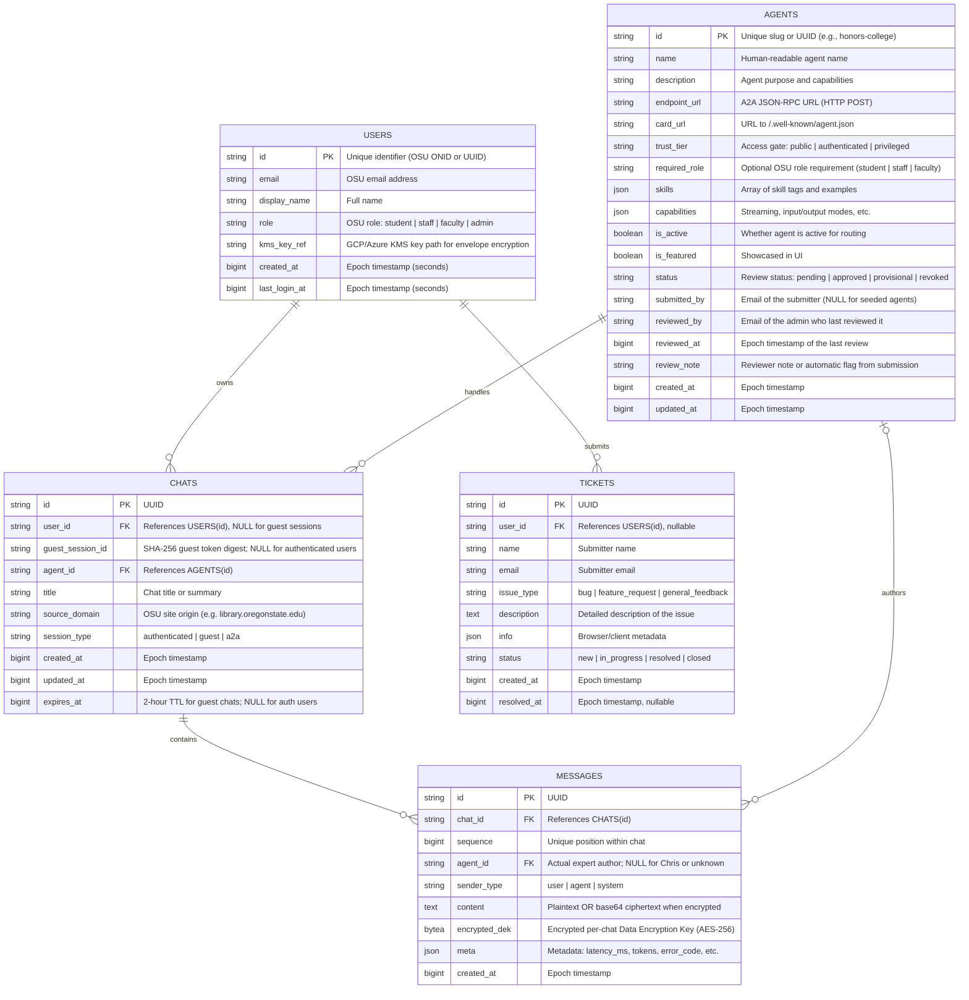

# Database Architecture & Simplification Plan — OpenBeavs v2

## 1. Executive Summary

This document presents the architectural analysis of the legacy OpenBeavs (v1) database, the rationale for simplifying it in OpenBeavs v2, and the concrete target schema.

The legacy repository was built as a direct fork of **Open WebUI**, inheriting over 20 tables, dual ORMs (`Peewee` and `SQLAlchemy`), embedded vector databases (`ChromaDB`), and local password authentication. Because OpenBeavs is fundamentally an **A2A (Agent-to-Agent) protocol discovery hub and orchestrator for Oregon State University**, more than 80% of the inherited schema was dead weight.

In OpenBeavs v2, the database is streamlined into **5 core tables** managed by a single modern ORM (**SQLAlchemy 2.0** with **Alembic**). This reduces operational overhead, removes cold-start latency on Google Cloud Run, enables true message streaming and pagination, and aligns directly with OSU's Microsoft SSO (OIDC) identity model.

---

## 2. Legacy V1 Analysis: Where the Bloat Came From

### 2.1 The Open WebUI Inheritance
Open WebUI is designed as a self-hosted ChatGPT clone with pipelines, Slack-style channels, RAG, Ollama management, code execution valves, and local user management. By inheriting this codebase, OpenBeavs v1 acquired:
- **Unused Feature Tables:** `channel`, `message_reaction`, `function` (Python code valves), `tool` (internal plugins), `memory` (per-user LLM memory snippets), `prompt` (slash-command library), `folder`, `tag`, `chatidtag`.
- **Embedded Vector Databases:** `document`, `knowledge`, ChromaDB (`chroma.sqlite3`), and PgVector configurations. In the A2A model, **downstream agents** (e.g. `oregon-state-expert`, `oregon-state-scraper`) manage their own retrieval and embeddings. The hub is a router, not a vector store.

### 2.2 Dual ORMs and Conflicting Migration Routers
In `front/backend/open_webui/internal/db.py`:
- The application initialized both Peewee and SQLAlchemy.
- On every server start, `handle_peewee_migration` spun up `peewee_migrate.Router` over the database connection before Alembic ran SQLAlchemy migrations.
- Custom wrappers, regex URL replacements (`postgresql://` vs `postgres://`), and custom type decorators (`JSONField`) were required to bridge the two ORMs, causing startup delays and connection leaks.

### 2.3 Duplicate Agent Models
The v1 codebase maintained two conflicting agent tables:
1. `agent` (`models/agents.py`): Built for internal runtime agents (system prompts, provider, deployment mode).
2. `registry_agent` (`models/registry.py`): Built for external A2A agents (`card_url`, tools, access control).

Both models attempted to call `create_all(bind=engine)` inside their constructors, bypassing Alembic migrations until later patches forced migrations like `b2c3d4e5f6a7_add_trust_tier_columns.py` to alter both tables in lockstep.

### 2.4 Monolithic JSON Chat Blobs vs. Relational Messages
- In legacy `Chat`, the entire multi-turn conversation was stored as a single JSON object in `chat` (or AES-256 encrypted blob in `content_enc`).
- **Performance Cost:** Adding a single message required loading, decrypting, deserializing, appending, re-serializing, and re-encrypting the *entire conversation history*.
- **Functional Limitations:** Prevented efficient message pagination, individual turn flagging, SQL-level search, and standard relational auditing.

### 2.5 Local Password Auth vs. OSU Microsoft SSO
- Legacy v1 included an `auth` table for local email/password authentication.
- Team members experienced bugs with password hashing (e.g. `passlib` 72-byte truncation issues documented in `BCRYPT_BUG_FIX.md`).
- For OSU deployment, local passwords create shadow identity vulnerabilities. The production system requires Microsoft SSO (Azure MSAL / OIDC) and temporary guest sessions.

---

## 3. OpenBeavs V2 Database Architecture

### 3.1 Design Principles
1. **Single Responsibility:** The hub stores only registry discovery metadata, routing state, conversation history, and user session references.
2. **Single Modern ORM:** SQLAlchemy 2.0 (async/sync) with Alembic for migrations. No dual ORM wrappers.
3. **Relational Messages:** Conversations are broken down into indexed, sequential message rows rather than monolithic JSON blobs.
4. **Native SSO & Privacy:** Identity and encryption fields are modeled; SSO and encryption are not implemented. Guest expiry is enforced and an admin cleanup endpoint is available, but scheduling remains a deployment task.
5. **Multi-Environment Parity:** Standard relational schema that runs on SQLite for fast local development and PostgreSQL on Google Cloud SQL in production.

---

### 3.2 Entity-Relationship Diagram (ERD)

---

## 4. Table Specifications

### 4.1 `agents`
Unified table replacing legacy `agent` and `registry_agent`.
- **`id`** (`String`, PK): Canonical identifier (slug like `honors-college` or UUID).
- **`name`** (`String`, NOT NULL): Display name of the agent.
- **`description`** (`Text`): Description of what the agent does.
- **`endpoint_url`** (`String`, NOT NULL): The A2A JSON-RPC URL (`/message/send`).
- **`card_url`** (`String`, UNIQUE): URL to the agent's hosted `/.well-known/agent.json`. One registry entry per card URL.
- **`trust_tier`** (`String`, NOT NULL, default `'public'`): Access tier required:
  - `public`: Accessible to all users including unauthenticated guests.
  - `authenticated`: Requires active OSU OIDC session.
  - `privileged`: Requires step-up MFA (e.g. Duo).
- **`required_role`** (`String`, NULL): Specific OSU role required (`student`, `staff`, `faculty`).
- **`skills`** (`JSON`): Extracted skills, tags, and sample queries for the orchestrator router.
- **`capabilities`** (`JSON`): Supported modes (streaming, audio, multimodal).
- **`is_active`** (`Boolean`, default `True`): Allows soft deactivation.
- **`is_featured`** (`Boolean`, default `False`): Curated agent highlight on the homepage.
- **`status`** (`String`, NOT NULL, no database default): Registry review status. `pending` (submitted, not routable), `approved` or `provisional` (routable), `revoked` (not routable). The registry creates new rows as `pending`; only an admin review changes it. Chris routes only to active agents that are `approved` or `provisional`. See `docs/registry.md`.
- **`submitted_by`** (`String`, NULL): Email of the submitter; NULL for seeded agents.
- **`reviewed_by`** (`String`, NULL): Email of the admin who last reviewed the agent.
- **`reviewed_at`** (`BigInteger`, NULL): Epoch seconds of the last review.
- **`review_note`** (`Text`, NULL): Reviewer note, or an automatic flag raised when the card was submitted.
- **`created_at`** (`BigInteger`): Creation timestamp (epoch seconds).
- **`updated_at`** (`BigInteger`): Last card synchronization/update timestamp.

### 4.2 `users`
Represents verified OSU identities. Local passwords are removed entirely.
- **`id`** (`String`, PK): OSU ONID or unique OIDC subject identifier (`sub`).
- **`email`** (`String`, UNIQUE, NOT NULL): Official `@oregonstate.edu` email.
- **`display_name`** (`String`): User's name from SSO token claims.
- **`role`** (`String`, default `'student'`): Role claim (`student`, `staff`, `faculty`, `admin`).
- **`kms_key_ref`** (`Text`, NULL): Key Management Service (KMS) key path for user envelope encryption.
- **`created_at`** (`BigInteger`): First login timestamp.
- **`last_login_at`** (`BigInteger`): Most recent session refresh timestamp.

### 4.3 `chats`
Represents conversation sessions started from the web app or embedded Floating Action Buttons (FAB).
- **`id`** (`String`, PK): UUIDv4 session identifier.
- **`user_id`** (`String`, FK -> `users.id`, NULL): NULL if started by an unauthenticated guest.
- **`guest_session_id`** (`String`, NULL): Ephemeral session token for guests; NULL for authenticated users.
- **`agent_id`** (`String`, FK -> `agents.id`, NULL): Current active agent (or NULL if routed via Chris).
- **`title`** (`String`): Conversation title generated from the first prompt.
- **`source_domain`** (`String`, NULL): OSU domain where the chat originated (e.g. `library.oregonstate.edu`) for domain history isolation.
- **`session_type`** (`String`, NOT NULL): `'authenticated'`, `'guest'`, or `'a2a'`.
- **`created_at`** (`BigInteger`): Session start epoch.
- **`updated_at`** (`BigInteger`): Timestamp of the last received message.
- **`expires_at`** (`BigInteger`, NULL): Set to `created_at + 86400` (24h) for guest sessions; NULL for authenticated users.

### 4.4 `messages`
Individual conversational turns replacing monolithic JSON arrays.
- **`id`** (`String`, PK): UUIDv4 message identifier.
- **`chat_id`** (`String`, FK -> `chats.id`, index): Links to the chat session.
- **`sender_type`** (`String`, NOT NULL): `'user'`, `'agent'`, or `'system'`.
- **`content`** (`Text`, NOT NULL): Message content (or base64 ciphertext if encrypted).
- **`encrypted_dek`** (`LargeBinary`, NULL): Data Encryption Key (DEK) wrapped by user KMS key. NULL if unencrypted.
- **`meta`** (`JSON`, NULL): Non-sensitive metadata (routing latency, token counts, error states).
- **`created_at`** (`BigInteger`, index): Epoch timestamp in seconds; ordering uses `sequence`.

### 4.5 `tickets`
Support and bug feedback tracking.
- **`id`** (`String`, PK): UUIDv4.
- **`user_id`** (`String`, FK -> `users.id`, NULL): Optional link to submitter.
- **`name`** (`String`): Contact name.
- **`email`** (`String`): Contact email.
- **`issue_type`** (`String`): `'bug'`, `'feature_request'`, or `'general_feedback'`.
- **`description`** (`Text`): User explanation.
- **`info`** (`JSON`): Client telemetry (browser version, OS, current page).
- **`status`** (`String`, default `'new'`): `'new'`, `'in_progress'`, `'resolved'`, `'closed'`.
- **`created_at`** (`BigInteger`): Submission timestamp.
- **`resolved_at`** (`BigInteger`, NULL): Closure timestamp.

---

## 5. Security, Privacy & Retention Architecture

1. **Guest Sessions & 24h Purge:**
   - Unauthenticated users receive an ephemeral `guest_session_id`.
   - Records have `expires_at = now() + 24 hours`.
   - An authorized caller invokes `DELETE /chris/chats/expired`; scheduling remains to be configured. Deleting a guest chat also deletes its messages.
2. **Guest Promotion:**
   - When a guest logs in via OSU SSO mid-conversation, `chats.user_id` is set to the authenticated user ID, `guest_session_id` is cleared, and `expires_at` is set to `NULL`.
3. **Envelope Encryption:**
   - Sensitive user chats are encrypted using AES-256-GCM.
   - A random per-chat Data Encryption Key (DEK) encrypts messages.
   - The DEK is encrypted with the user's KMS wrapping key (`kms_key_ref`) and stored in `messages.encrypted_dek`.
   - Plaintext keys never touch the database disk.

---

## 6. Summary of Benefits: V1 vs. V2

| Dimension | Legacy OpenBeavs (v1) | OpenBeavs v2 (Target) |
| :--- | :--- | :--- |
| **Table Count** | **20+ tables** | **5 core tables** |
| **ORM Framework** | Dual: `Peewee` + `SQLAlchemy` | Pure modern `SQLAlchemy 2.0` |
| **Migrations** | Dual: `peewee_migrate` + `Alembic` | Standard `Alembic` only |
| **Agent Modeling** | Fragmented (`agent` & `registry_agent`) | Unified `agents` registry |
| **Chat Storage** | Monolithic JSON/ciphertext blob | Relational `messages` with foreign keys |
| **Message Streaming** | Must rewrite whole JSON on each token/turn | Direct single-row insertion |
| **Vector DB in Hub** | ChromaDB SQLite + PgVector | **Zero** (delegated to A2A agents) |
| **Authentication** | Local password auth + bcrypt bugs | Pure OSU Microsoft SSO / OIDC |
| **Container Footprint** | Heavy (multi-GB Open WebUI base) | Minimal lightweight FastAPI service |
| **Cloud Run Cold Start** | High (~10–20s dual ORM/migration boot) | Fast (<1s instant readiness) |

---

## 7. Implementation Roadmap for V2

1. **Phase 1: Database Setup**
   - Create `backend/app/db/session.py` with SQLAlchemy 2.0 `create_async_engine` (or sync `engine`) and connection pooling.
   - Set up Alembic in `backend/alembic/` configured to target `backend/app/models/`.
2. **Phase 2: Model Definitions**
   - Implement `Agent`, `User`, `Chat`, `Message`, and `Ticket` in `backend/app/models/`.
3. **Phase 3: Chris Orchestrator Integration**
   - Replace in-memory `MOCK_AGENTS` in `backend/app/chris/agents.py` with queries against the live `agents` table.
   - Connect `POST /chris/message` to persist conversation history into `chats` and `messages`.
4. **Phase 4: SSO & Guest Gateway**
   - Wire OIDC token claims into `users` table auto-provisioning.
   - Implement guest session creation with 2-hour expiration TTL.

## Current alignment notes (2026-10-26)

The security/encryption lifecycle above includes target architecture, not completed
SSO or encryption functionality. See `../chris.md` for the implemented API contract.
Messages now include a non-null per-chat `sequence` and nullable expert `agent_id`.
The checked-in PNG is a historical diagram; the Mermaid source reflects these additions.
Setup uses Alembic exclusively; the create-tables SQL is a reference export.
Both seed paths insert only missing rows and preserve existing settings and URLs.
Guest ownership uses a server-issued bearer credential stored as a SHA-256 digest.
