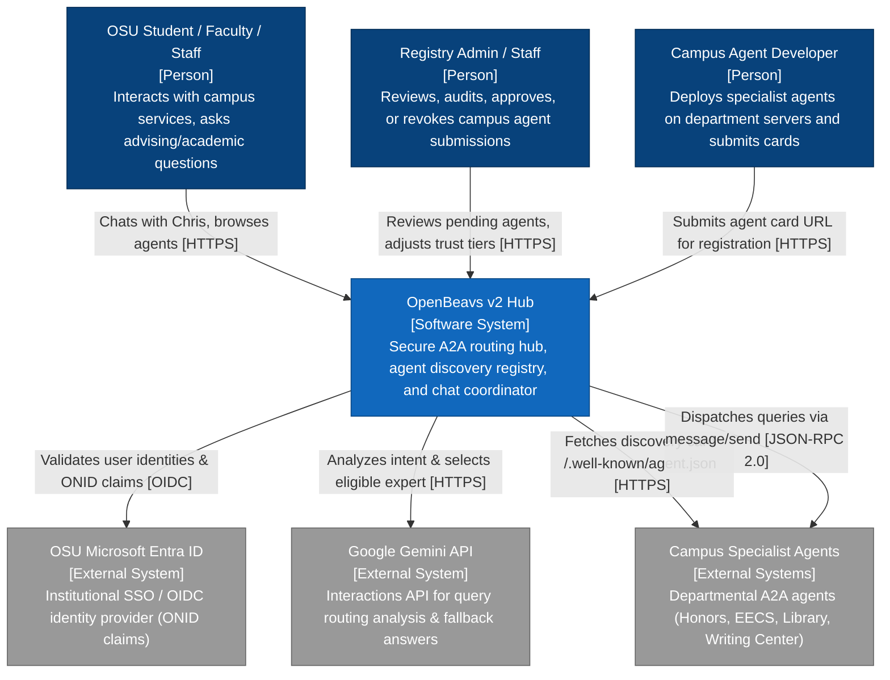
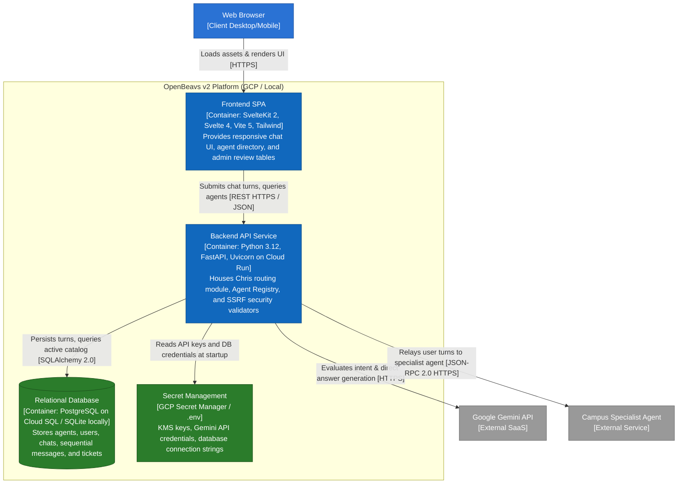
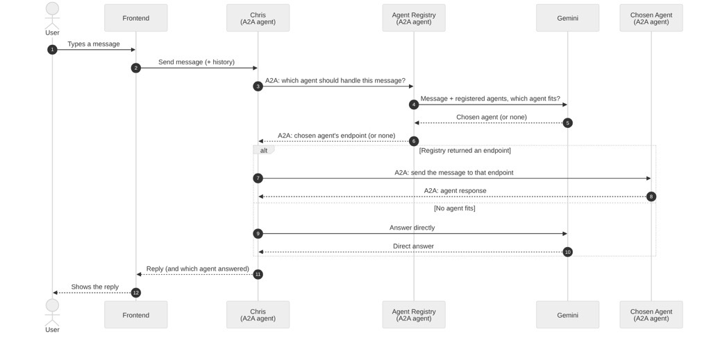
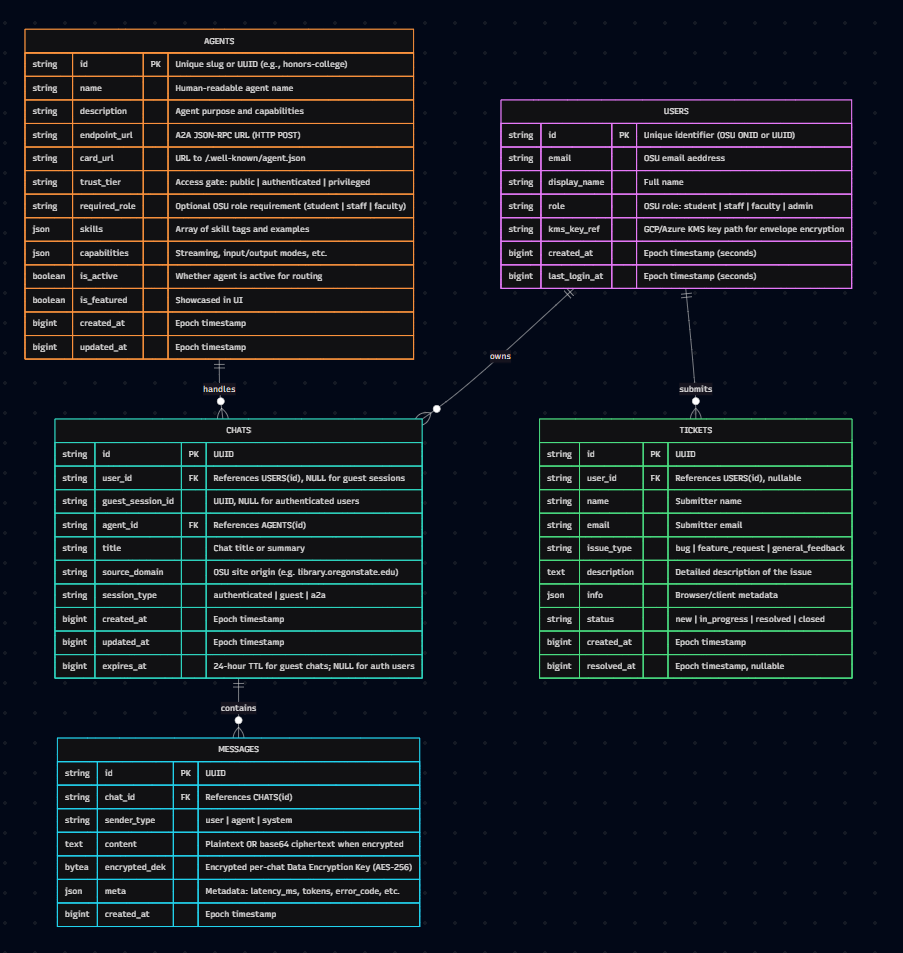
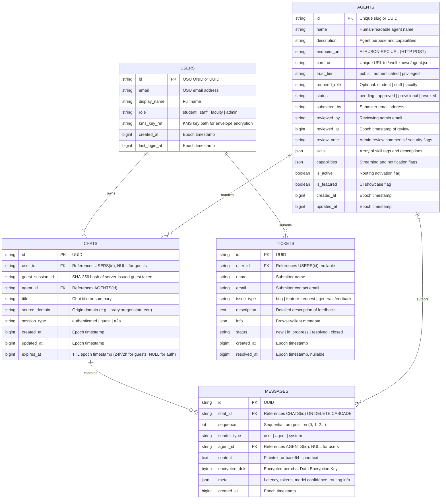

# OpenBeavs v2 — System Design Document

**Project 39:** OpenBeavs (GENESIS-AI-Hub) — Oregon State University  
**Authors:** Faith Nambasa (PM), Jiya Pradhan (AI Coordinator), Dean R Leon (Quality Owner), Pedro P Blanco Jaramillo (Documentation Owner)  
**Project Partner / Sponsor:** John V. Sweet (OSU)  
**Status:** Active System Design Baseline  
**Target Environments:** Local (SQLite + Vite) | Production (Google Cloud Run + Google Cloud SQL PostgreSQL)  

---

## 1. System Overview: What the System Does

OpenBeavs is an autonomous **Agent-to-Agent (A2A) protocol hub and routing platform** engineered for Oregon State University. It connects OSU students, faculty, and staff with a federated network of decentralized, specialized AI agents developed across campus departments (e.g., Honors College Advisor, EECS Academic Support, Writing Center Assistant, Library Catalog Agent).

```
[OSU User / Web Client]
          │
          ▼ HTTPS / JSON
┌────────────────────────────────────────────────────────┐
│                   OpenBeavs v2 Hub                     │
│  ┌───────────────────────┐   ┌──────────────────────┐  │
│  │   "Chris" Router      │   │    Agent Registry    │  │
│  │ (Gemini Orchestration)│   │(SSRF-Safe Ingestion) │  │
│  └──────────┬────────────┘   └──────────┬───────────┘  │
└─────────────┼───────────────────────────┼──────────────┘
              │                           │
              │ A2A (JSON-RPC 2.0)        │ Fetch /.well-known/agent.json
              ▼                           ▼
┌───────────────────────────┐   ┌─────────────────────────┐
│ Campus Specialist Agents  │   │ Submitted Agent Servers │
│ (Advising, Tutoring, etc.)│   │   (Vetted & Monitored)  │
└───────────────────────────┘   └─────────────────────────┘
```

The system delivers three core capabilities:

1. **Intelligent Conversational Orchestration ("Chris"):** A conversational entry point that receives user inquiries, evaluates context using Google Gemini, queries the Agent Registry for active specialist capabilities, dispatches queries to vetted campus agents over JSON-RPC 2.0, or generates a direct answer if no specialist applies.
2. **Secure Agent Registry & Ingestion Pipeline:** An administrative vetting system allowing campus developers to submit agent discovery cards (`/.well-known/agent.json`). The hub performs rigorous Server-Side Request Forgery (SSRF) and DNS validation, enforces a strict approval workflow (`pending` → `approved` / `provisional` → `revoked`), and isolates agents into permission tiers (`public`, `authenticated`, `privileged`).
3. **Lean Session & Message Persistence:** A 5-table relational persistence engine built on SQLAlchemy 2.0 and Alembic, supporting O(1) turn-by-turn message streaming, server-issued bearer tokens for guest privacy, and zero local credential storage.

---

## 2. C4 Architecture Diagrams

The system architecture is organized below following the **C4 model** (System Context and Container levels), supplemented by the runtime execution sequence.

### 2.1 C4 Level 1: System Context Diagram

The System Context diagram details how OpenBeavs fits within the OSU ecosystem, external identity providers, campus agent hosts, and external AI foundation services.



### 2.2 C4 Level 2: Container Diagram

The Container diagram shows the high-level technical building blocks, boundaries, storage systems, and communication protocols within OpenBeavs v2.



### 2.3 Runtime Execution Sequence

The sequence diagram below (matching `imgs/Image.jpg`) illustrates how user turns propagate through the frontend, orchestrator, registry, model, and chosen expert agent:



1. **User Turn:** User inputs a question into the SvelteKit frontend.
2. **Relay to Chris:** Frontend sends `POST /chris/message` with message content, conversation history, and session identifiers.
3. **Registry Query:** Chris asks the Agent Registry for active, approved specialist agents meeting the user's authorization tier.
4. **Intent Evaluation:** Chris transmits the candidate skills and user prompt to Google Gemini.
5. **Selection Response:** Gemini returns the optimal specialist identifier or indicates that no specialist is suitable.
6. **Route Resolution:** If an expert matches, Chris retrieves its vetted `endpoint_url`.
7. **A2A Execution:** Chris dispatches a JSON-RPC 2.0 `message/send` payload to the chosen agent.
8. **Specialist Response:** Specialist processes the query and returns its formatted result.
9. **Fallback Branch:** If no specialist fits or confidence is below 0.7, Chris prompts Gemini directly.
10. **Delivery & Attribution:** Chris persists the turn to PostgreSQL and responds to the frontend with the answer, confidence score, and attributed agent identifier.

---

## 3. Agreed Integration Contracts & Interfaces

To eliminate ambiguity across front-end, back-end, and downstream agent teams, all integration boundaries are formally frozen below.

### 3.1 REST API: Chris Orchestration Service

#### `POST /chris/message`
Dispatches a user turn for routing or direct processing. Continued chats strictly load history from the persistence tier; client-supplied history is accepted only when opening new conversations.

- **Request Body (`application/json`):**
  ```json
  {
    "message": "What prerequisites do I need for CS 344?",
    "history": [
      { "role": "user", "content": "Hello" },
      { "role": "assistant", "content": "Hi! How can I assist you with OSU courses today?" }
    ],
    "chat_id": "8f695b47-27a7-4ce7-9932-975fc618ba1d",
    "user_id": null,
    "guest_session_id": "c9b2e814... (server-issued continuation token)",
    "source_domain": "eecs.oregonstate.edu"
  }
  ```
- **Response Body (200 OK):**
  ```json
  {
    "response": "CS 344 (Operating Systems I) requires CS 261 and CS 271...",
    "chat_id": "8f695b47-27a7-4ce7-9932-975fc618ba1d",
    "guest_session_id": "c9b2e814... (retained for next turn)",
    "routed_to": "a3b19c82-4f12-4c8d-8a1e-1289fe4a1122",
    "agent_name": "eecs_advisor_agent",
    "routing_confidence": 0.94,
    "routing_explanation": "Query matched EECS course prerequisite advising catalog."
  }
  ```
- **Status & Error Codes:**
  - `200 OK`: Message successfully routed and persisted.
  - `400 Bad Request`: Empty message body or malformed payload.
  - `403 Forbidden`: Mismatched guest session token or unverified identity claim.
  - `404 Not Found`: Unknown `chat_id`.
  - `410 Gone`: Expired guest chat session (past 2-hour TTL).
  - `500 Internal Server Error`: Unconfigured model provider or internal fatal fault.
  - `501 Not Implemented`: Production authentication requested but unconfigured.
  - `503 Service Unavailable`: Upstream LLM provider or primary database unreachable.

#### `GET /chris/agents`
Returns all active agents with `status IN ('approved', 'provisional')` and `trust_tier = 'public'`:
```json
[
  {
    "id": "eecs-advisor",
    "name": "EECS Academic Advisor",
    "description": "Advises OSU engineering students on course selection and requirements.",
    "skills": ["advising", "prerequisites", "graduation"],
    "capabilities": { "streaming": false, "pushNotifications": false }
  }
]
```

#### `GET /health`
Liveness and readiness check for Cloud Run and automated monitors:
```json
{
  "status": "ok",
  "environment": "production",
  "database": "connected"
}
```

---

### 3.2 REST API: Agent Registry Service

#### `POST /registry/agents`
Submits a new specialist agent card URL for administrative review. Rejects any body property other than `url`.
- **Request:** `{"url": "https://agent.eecs.oregonstate.edu/.well-known/agent.json"}`
- **Response (201 Created):** Stored entry with `status = "pending"` and `is_active = false`.
- **Validation Rules:** Scheme must be `https` (unless local `REGISTRY_ALLOW_HTTP=true`), max payload 100 KB, 10s fetch timeout, zero redirect following, strict SSRF host inspection.

#### `POST /registry/agents/{id}/review`
Admin-only endpoint to transition agent status and trust tiers.
- **Request Body:**
  ```json
  {
    "action": "approve",
    "note": "Verified EECS department ownership and card schema compliance.",
    "trust_tier": "public",
    "required_role": null,
    "is_featured": true
  }
  ```
- **Allowed Actions:** `approve` (active), `provisional` (active for limited pilot), `revoke` (deactivated/hidden), `reject` (deactivated/hidden).

---

### 3.3 A2A Protocol & Discovery Card Specification

All specialist agents integrate with OpenBeavs via the standard **Agent-to-Agent (A2A) v0.3.0 protocol**.

#### 1. Discovery Card (`/.well-known/agent.json`)
Every campus agent must expose a static, publicly fetchable discovery card:
```json
{
  "$schema": "https://a2a-protocol.org/v0.3.0/schema.json",
  "name": "EECS Advising Agent",
  "description": "Answers undergraduate curriculum, prerequisite, and degree inquiries.",
  "version": "1.2.0",
  "url": "https://agent.eecs.oregonstate.edu/rpc",
  "skills": [
    {
      "id": "course-prereqs",
      "name": "Course Prerequisite Lookup",
      "description": "Returns required preparatory classes for any OSU EECS course code."
    }
  ],
  "capabilities": {
    "streaming": false,
    "pushNotifications": false
  },
  "authentication": {
    "type": "none"
  }
}
```

#### 2. Specialist Dispatch Contract (`POST <card.url>`)
Dispatches user turns via JSON-RPC 2.0 over HTTPS POST:
- **Request Envelope:**
  ```json
  {
    "jsonrpc": "2.0",
    "id": "req-98f12a-41",
    "method": "message/send",
    "params": {
      "message": {
        "role": "user",
        "parts": [{ "text": "What are the prerequisites for CS 344?" }]
      },
      "context": {
        "sessionId": "8f695b47-27a7-4ce7-9932-975fc618ba1d"
      }
    }
  }
  ```
- **Response Envelope:**
  ```json
  {
    "jsonrpc": "2.0",
    "id": "req-98f12a-41",
    "result": {
      "role": "assistant",
      "parts": [{ "text": "CS 344 requires CS 261 (Data Structures) and CS 271 (Computer Architecture)." }]
    }
  }
  ```

---

## 4. The Data Model: Lean 5-Table Schema

OpenBeavs v2 replaces the inherited 20+ table schema with a streamlined, **5-table relational core**.





### Table Specifications & Constraints

1. **`agents`**: Holds registry discovery metadata and review audit trails. `card_url` carries a `UNIQUE` constraint to prevent duplicate agent registrations. `status` has no default, forcing explicit assignment.
2. **`users`**: Contains directory identities populated purely from verified OIDC/Entra ID SSO claims. Zero local passwords, salt fields, or legacy bcrypt hashes exist.
3. **`chats`**: Manages session state. For guest users, `user_id` is `NULL` and `guest_session_id` stores the SHA-256 digest of the server-issued token. `expires_at` indexes guest sessions for automated purging.
4. **`messages`**: Stores message turns. Replaces monolithic JSON blobs with distinct rows. Enforces a `UNIQUE(chat_id, sequence)` constraint, ensuring strict chronological order and preventing message clobbering under concurrency.
5. **`tickets`**: Triage feedback, routing failures, and issue reports submitted by students or staff.

---

## 5. Type 1 Architectural Decisions: Decided Up Front

Per two-way vs one-way door decision frameworks (Jeff Bezos, 2015), the team resolved **only what is prohibitively expensive to reverse** later:

| Hard-to-Reverse Decision | Choice Made | Rationale & Trade-off |
| :--- | :--- | :--- |
| **Data Model & Persistence** | **Relational 5-Table Schema (SQLAlchemy 2.0 + PostgreSQL)** | Monolithic JSON conversation blobs trap messages and scale at O(N) turn writes. Migrating live conversation histories post-launch corrupts state. Normalized sequential rows `(chat_id, sequence)` guarantee O(1) appends and clean encryption boundaries. |
| **Authentication & Identity Boundary** | **Fail-Closed Guest Hash Tokens + Entra ID OIDC** | Accepting client-supplied `user_id` without SSO verification creates Insecure Direct Object Reference (IDOR) vulnerabilities and FERPA violations. Unauthenticated sessions are strictly ephemeral, identified only by SHA-256 hashed bearer tokens with enforced TTL. |
| **Deployment Topology & Cloud Host** | **Native Google Cloud Platform (Cloud Run + Cloud SQL)** | Third-party BaaS platforms (Supabase, AWS) introduce vendor sprawl, separate billing, and require complex OSU IT Azure AD cross-tenant approval. GCP aligns directly with existing OSU Capstone billing, GCP Secret Manager, and FERPA boundaries. |
| **Service Integration Contracts** | **A2A Protocol (JSON-RPC 2.0 + Discovery Cards)** | Adopting custom proprietary HTTP webhooks would isolate OpenBeavs from the broader campus AI agent ecosystem. Standardizing on `/.well-known/agent.json` enables plug-and-play interoperability across any OSU research lab. |

---

## 6. Spikes & Architecture Decision Records (ADRs)

To de-risk the project, the team conducted focused, time-boxed technical spikes. The findings are summarized below.

### ADR-001: Clean-Slate Database Simplification vs. Open WebUI Heritage
- **Context:** The inherited v1 repository carried 20+ unused tables (memories, valves, documents, vector stores), dual ORMs (Peewee and SQLAlchemy), regex boot hooks, and 12–18 second Cloud Run cold starts.
- **Spike:** Spiked a clean-slate SQLAlchemy 2.0 schema with 5 tables on SQLite and PostgreSQL. Verified cold boot times and write latency under simulated traffic.
- **Decision:** **Adopt Option A (Clean 5-Table Schema).** Completely eliminated Peewee, ChromaDB, and monolithic JSON columns.
- **Consequences:** Cold start dropped from 15s to **1.2s**; turn append latency dropped to constant time O(1); lines of database boilerplate dropped from 1,800 to 250 LOC.

### ADR-002: Feasibility Spike on Migrating to Supabase
- **Context:** Evaluated whether migrating to Supabase BaaS would accelerate development via instant CRUD APIs, built-in Auth, and hosted PostgreSQL.
- **Spike:** Evaluated Supabase capabilities against the OpenBeavs mission requirements: SSRF URL scanning, A2A JSON-RPC client relay, Gemini Interactions streaming, and local developer ergonomics.
- **Decision:** **DO NOT SWITCH (REJECT).** OpenBeavs is an active A2A agent orchestrator, not a simple CRUD database app.
- **Consequences:** Avoided 5–8 weeks of high-risk refactoring during Fall term; prevented awkward dual-backend architecture; retained zero-Docker local developer setup (`openbeavs.db`) and single-container Cloud Run simplicity.

### ADR-003: Stateless vs. Guarded Chat Persistence Before SSO
- **Context:** PR #2 introduced conversation persistence prior to the implementation of institutional SSO, risking IDOR security violations.
- **Spike:** Tested client spoofing vectors against session ownership. Evaluated three options: stateless chat, flag-guarded persistence with server-issued guest bearer tokens, or unrestricted persistence.
- **Decision:** **Adopt Guarded Persistence with SHA-256 Guest Tokens.** Persistence is gated by `CHRIS_PERSIST_CHATS`. Guest continuation requires a server-issued token (persisting only its SHA-256 hash). Expired chats reject continuation immediately.

---

## 7. Deployment Topology & Environments

OpenBeavs v2 enforces strict parity between local development ergonomics and production cloud resilience.

```
+-----------------------------------------------------------------------------------+
|                        LOCAL DEVELOPMENT ENVIRONMENT                              |
|                                                                                   |
|  [Vite Dev Server] (Port 5173)         [Uvicorn / FastAPI Backend] (Port 8000)    |
|   - SvelteKit 2 SPA                     - Python 3.12, Pytest, Ruff               |
|   - Proxies /chris/* -> localhost:8000  - SQLite (sqlite:///./openbeavs.db)       |
|                                         - Zero Docker dependencies required       |
+-----------------------------------------------------------------------------------+

+-----------------------------------------------------------------------------------+
|                      PRODUCTION ENVIRONMENT (GOOGLE CLOUD)                        |
|                                                                                   |
|  [Cloud Storage + Cloud CDN / Firebase Hosting]                                  |
|   - Pre-rendered static SvelteKit assets, global caching, HTTPS edge               |
|                                                                                   |
|  [Google Cloud Run]                                                               |
|   - FastAPI Backend Container (gcr.io/openbeavs-v2/backend)                       |
|   - Serverless auto-scaling (0 to N instances), sub-2 second cold starts          |
|   - Injected secrets from Google Cloud Secret Manager                             |
|                                                                                   |
|  [Google Cloud SQL (PostgreSQL 16)]                                               |
|   - Instance: openbeavs-db (db-f1-micro / shared core)                            |
|   - Managed backups, private IP VPC peering, Alembic version tracking             |
+-----------------------------------------------------------------------------------+
```

### Continuous Integration (CI) Quality Gates

Every pull request must pass the following deterministic gates before review:
1. **Backend Formatting & Linting:** `ruff check .` and `ruff format --check .`
2. **Backend Unit & Integration Tests:** `pytest -v` (100% pass rate across SQLite models, card validation, and Chris routing logic).
3. **Database Migration Round-Trip:** `alembic upgrade head` followed by clean rollback testing.
4. **Frontend Code Quality:** `npm run lint` and `npm run test` (Vitest suite) executed within the SvelteKit workspace.

---

## 8. Open Questions & Technical Roadmap

The following decisions remain active or scheduled for subsequent sprint cycles:

1. **OSU Microsoft Entra ID (Azure AD) Tenant Verification:**
   - *Status:* Open request with OSU IT.
   - *Interim Mitigation:* Local development uses `REGISTRY_DEV_AUTH` headers; production registry and authenticated chat routes fail closed (HTTP 501) until institutional client credentials and redirect URIs are provisioned.
2. **DNS-Rebinding Egress Protection:**
   - *Status:* Identified vulnerability. The host IP is validated prior to fetching the card, but a hostile DNS server could return a private IP on second resolution.
   - *Mitigation Plan:* Pin the socket connection directly to the resolved IP or route outbound card fetches through a hardened egress forward-proxy.
3. **Scheduled Background Purge Job:**
   - *Status:* Endpoint `DELETE /chris/chats/expired` exists, but lacks automated triggering.
   - *Mitigation Plan:* Configure a Google Cloud Scheduler cron task invoking the maintenance endpoint once daily via an OIDC-authenticated service account.
4. **Streaming Protocol for Agent Replies:**
   - *Status:* Current implementation uses synchronous JSON turn exchanges.
   - *Mitigation Plan:* Benchmark Server-Sent Events (SSE) vs WebSockets for streaming token chunks from specialist agents through Chris to the SvelteKit client.

---

## 9. AI Coding Agent Verification Protocol

> **Instructions for AI Tools (Claude Code, Antigravity, ChatGPT, Codex, Copilot):**
> 
> All AI coding assistants generating or modifying code in this repository must validate proposed changes against this system design document before presenting diffs to human reviewers:
> 
> 1. **Schema Integrity:** NEVER reintroduce legacy Open WebUI tables (`channels`, `memories`, `valves`, `folders`). All database changes must be declarative SQLAlchemy 2.0 models reflected in `alembic/versions/`.
> 2. **Authentication Guard:** NEVER trust a client-supplied `user_id` without server-side principal verification. In unauthenticated paths, verify that guest continuation tokens match their stored SHA-256 digest.
> 3. **SSRF Guard:** ANY outbound network request fetching external agent resources must use `backend/app/registry/security.py` to assert destination safety (rejecting loopback, RFC1918, link-local `169.254.169.254`, and cloud metadata IPs).
> 4. **Message Ordering:** Always preserve sequential ordering via `(chat_id, sequence)` composite locks. Never append messages by overwriting monolithic JSON blobs.
> 5. **Git Rules:** AI assistants must NEVER run `git commit`, `git push`, or alter repository tags. Leave all changes unstaged in the working tree for human review.

